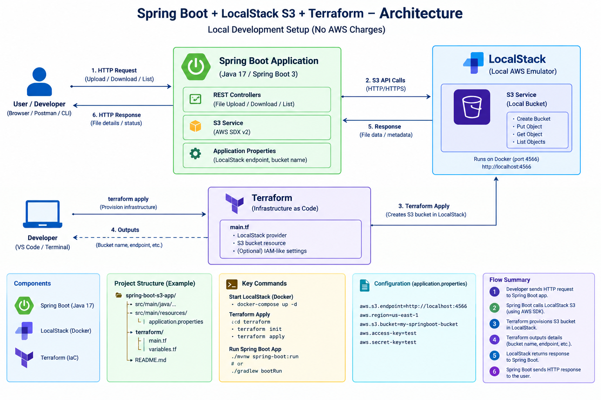

# Spring Boot + LocalStack S3 + Terraform

A local-only practice project: Terraform provisions an S3 bucket in LocalStack, and a Spring Boot REST API uploads, lists, downloads, and deletes files in that bucket.

## Architecture



This project is configured for local development. It does not need an AWS account, but LocalStack's current image/version and licensing requirements may change. Check its current documentation before use.

## Prerequisites

- Windows 11 with Docker Desktop running
- Java 17+
- Maven 3.9+ (or use a Maven wrapper if you add one)
- Terraform 1.5+
- PowerShell

## Clone Project
```cmd
git clone https://github.com/satya-moganti/springboot-local-s3-terraform.git
cd springboot-local-s3-terraform
```


## 1. Start LocalStack

From the project root:

```powershell
docker compose up -d localstack
docker compose ps
docker compose logs -f localstack
```

LocalStack endpoint: `http://localhost:4566`

## 2. Provision the bucket with Terraform

```powershell
cd terraform
terraform init
terraform fmt -recursive
terraform validate
terraform plan
terraform apply
```

Type `yes` when prompted. The bucket name is `practice-file-uploads` by default.

Verify the bucket using the AWS CLI in the LocalStack container:

```powershell
docker compose exec localstack awslocal s3 ls
```

Return to the root directory:

```powershell
cd ..
```

## 3. Run Spring Boot

In a new PowerShell terminal, from the project root:

```powershell
cd app
mvn spring-boot:run
```

The API listens on `http://localhost:8080`.

## 4. Test the API

Upload a file (PowerShell):

```powershell
Invoke-RestMethod -Uri "http://localhost:8080/api/files" `
  -Method Post -Form @{ file = Get-Item ".\..\sample.txt" }
  or 
  curl.exe -X POST "http://localhost:8080/api/files" -F "file=@sample.txt"
```

Create `sample.txt` first if needed:

```powershell
"Hello from Spring Boot + LocalStack S3" | Set-Content sample.txt
```

List files:

```powershell
Invoke-RestMethod -Uri "http://localhost:8080/api/files" -Method Get
```

Download a file (replace the key with the key returned by upload):

```powershell
Invoke-WebRequest -Uri "http://localhost:8080/api/files/sample.txt" `
  -OutFile ".\downloaded-sample.txt"
```

Delete a file:

```powershell
Invoke-RestMethod -Uri "http://localhost:8080/api/files/sample.txt" -Method Delete
```

For curl, upload using:

```bash
curl -F "file=@sample.txt" http://localhost:8080/api/files
curl http://localhost:8080/api/files
curl -o downloaded.txt http://localhost:8080/api/files/sample.txt
curl -X DELETE http://localhost:8080/api/files/sample.txt
```

## 5. Stop and clean up

Stop containers:

```powershell
docker compose down
```

Remove Terraform-managed local resources (run before stopping LocalStack if you want to destroy the bucket):

```powershell
cd terraform
terraform destroy
cd ..
docker compose down
```

LocalStack data is ephemeral in this starter setup. Do not put important files in it.

## API endpoints

| Method | Path | Purpose |
|---|---|---|
| POST | `/api/files` | Upload multipart file |
| GET | `/api/files` | List object keys |
| GET | `/api/files/{key}` | Download file |
| DELETE | `/api/files/{key}` | Delete file |

## Troubleshooting

- **Connection refused:** make sure Docker Desktop and LocalStack are running.
- **No bucket / NoSuchBucket:** run `terraform apply` and check the bucket name in `app/src/main/resources/application.yml` matches `terraform/variables.tf`.
- **Signature / credentials errors:** the app uses placeholder local credentials; do not replace them with real credentials for this local exercise.
- **Terraform cannot connect:** the AWS provider endpoint settings are in `terraform/providers.tf`; LocalStack must be running first.
- **Port in use:** stop the process occupying port 4566 or 8080, or adjust the Compose/application settings consistently.

